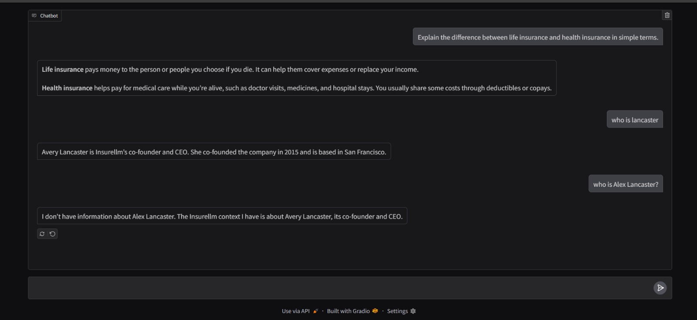
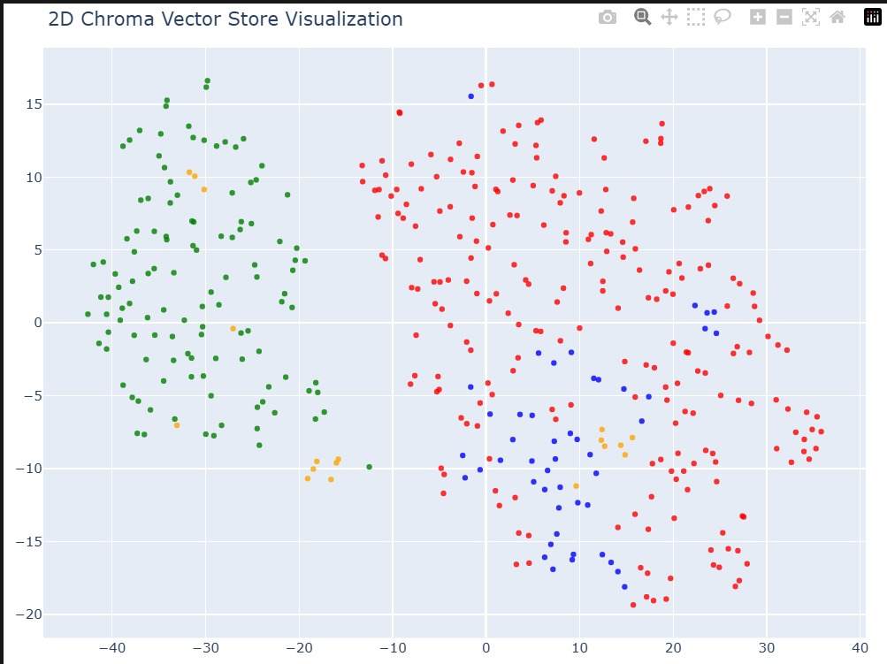
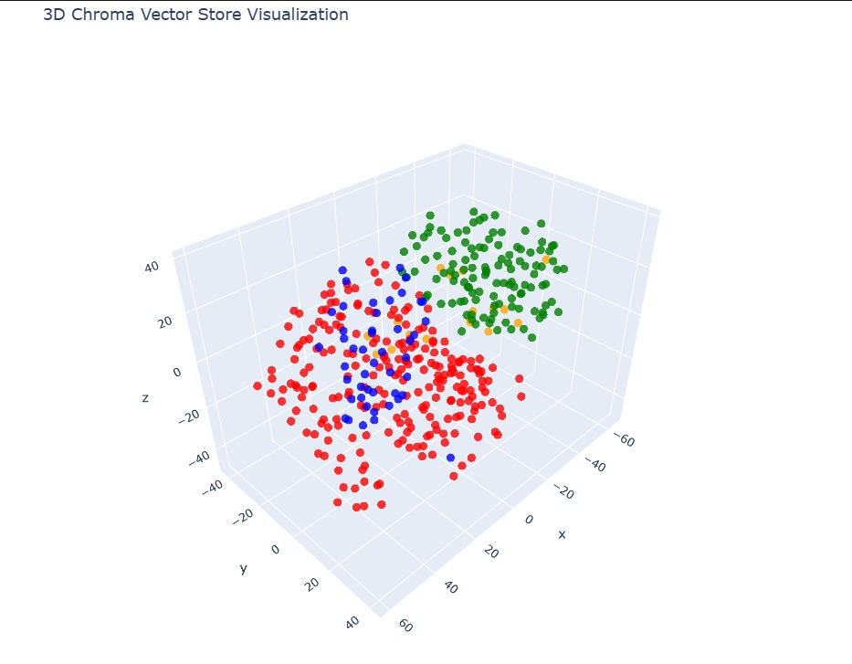
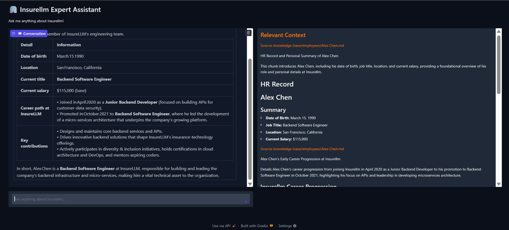
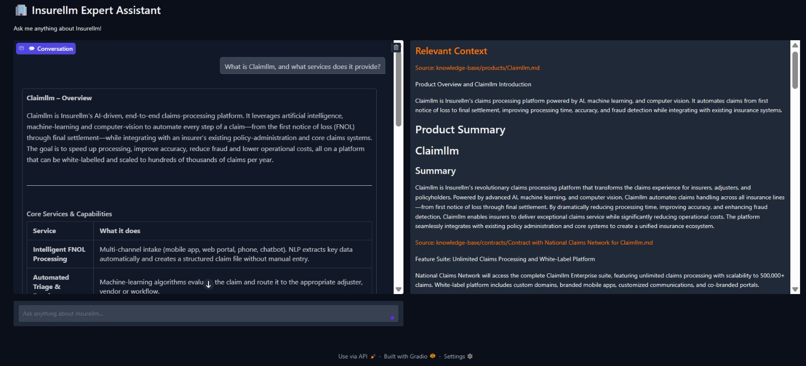

# Insurellm_Expert_Assistant
Retrieval-Augmented Generation (RAG) system for insurance knowledge retrieval using ChromaDB, semantic search, query rewriting, and reranking.

## Description
InsureLLM is a Retrieval-Augmented Generation (RAG) project that allows users to ask questions about an insurance company's employees, products, contracts, and business information.

Instead of depending only on the AI model's knowledge, the system searches company documents, finds relevant information, and uses it to generate answers.

The project was developed step by step, starting with a basic chatbot and progressing to an advanced RAG system with semantic search, query rewriting, document reranking, and answer evaluation.

## Objective
The main goal was to build a system that could:

- Answer questions using information from company documents.
- Find relevant documents based on meaning rather than exact keywords.
- Understand follow-up questions using conversation history.
- Generate answers supported by retrieved information.
- Display the source documents used to generate answers.
- Evaluate the quality of document retrieval and generated responses.

## Steps Followed

### Step 1: Built a Basic Chatbot (Day 1)

- Loaded company documents containing employee and product information.
- Created a keyword-based search function to find information related to user questions.
- Passed the relevant information to an AI model to generate answers.
- Used Gradio to create a chatbot interface.

**Result:** Built a basic chatbot that could answer questions using company information and respond to questions about insurance-related topics.

### Step 2: Created a Vector Database (Day 2)

- Loaded documents from the company knowledge base.
- Divided large documents into smaller sections called chunks.
- Converted these chunks into embeddings, which represent text as numerical vectors.
- Stored the embeddings in ChromaDB for efficient searching.
- Used semantic search to find information based on meaning instead of matching exact words.
- Visualized the embeddings in 2D and 3D to understand how different document chunks were distributed.

**Result:** Created a searchable vector database that could identify relevant information from company documents.

**2D ChromaDB Visualization**

**3D ChromaDB Visualization**

### Step 3: Developed the RAG Chatbot (Day 3)

- Connected the ChromaDB vector database to the chatbot.
- Created a retrieval system to find document chunks relevant to each question.
- Passed the retrieved information along with the user's question to the AI model.
- Generated answers based on the information retrieved from the documents.
- Tested the chatbot using questions about company information and employees.

The RAG process follows this workflow:

User Question → Document Retrieval → Relevant Context → AI Model → Generated Answer

**Result:** Built a RAG chatbot that searches company documents before answering questions.

### Step 4: Evaluated the RAG System (Day 4)

- Created test questions with reference answers and expected keywords.
- Checked whether the retrieval system found the correct information.
- Used Mean Reciprocal Rank (MRR) to measure how highly relevant information appeared in the search results.
- Used normalized Discounted Cumulative Gain (nDCG) to evaluate the ordering of retrieved information.
- Measured keyword coverage to check how much expected information was retrieved.
- Evaluated generated answers based on accuracy, completeness, and relevance.
- Created an evaluation dashboard using Gradio.

**Result:** Developed an evaluation process to measure how well the system retrieved information and generated answers.

The screenshot below shows an example evaluation with:

- Accuracy: 5/5
- Completeness: 5/5
- Relevance: 4/5

These scores represent one evaluation example, not the overall performance of the system.

### Step 5: Improved the RAG Pipeline (Day 5)

- Used an AI model to divide documents into meaningful chunks instead of relying only on fixed-size splitting.
- Added headings and summaries to each chunk to make the information easier to retrieve.
- Generated embeddings using OpenAI's `text-embedding-3-large` model.
- Stored the processed embeddings in a separate ChromaDB database.
- Added query rewriting to make user questions clearer using previous conversation history.
- Retrieved relevant documents using the original and rewritten questions.
- Added reranking to organize retrieved documents based on their relevance.
- Selected the most relevant documents before generating the final answer.

**Result:** Developed an advanced RAG pipeline that improves how questions are processed and how relevant information is selected.

### Step 6: Built the Final InsureLLM Application

- Connected the advanced RAG pipeline to the final Gradio application.
- Created a chatbot interface where users could ask questions about employees, products, and contracts.
- Added a separate panel to display the relevant documents retrieved from the knowledge base.
- Included conversation history to support follow-up questions.
- Tested the application with different types of questions.

**Result:** Built the final InsureLLM application, which answers questions using company documents and displays the supporting information.

**Example 1: Employee Information Retrieval**

The system retrieved information about an employee, including their job role, career history, and responsibilities.

The relevant employee documents were displayed alongside the generated answer.

**Example 2: Insurance Product Information Retrieval**

The system answered a question about Claimllm and explained its claims-processing services.

It retrieved information from the product documentation and related contracts to support the answer.

## Conclusion
Successfully developed a Retrieval-Augmented Generation system for retrieving and answering questions about insurance company information.

The project started with a basic keyword-based chatbot and gradually evolved into an advanced RAG system using ChromaDB, semantic search, document embeddings, query rewriting, and reranking.

The final application can retrieve relevant company documents, generate answers using the retrieved information, support follow-up questions, and display the sources used.

The project also included an evaluation system to measure retrieval quality and answer accuracy.

Through this project, I gained practical experience in RAG, LLMs, vector databases, document processing, semantic search, chatbot development, and AI evaluation.

## Files for GitHub

### Main Application
- `app.py` – Final Gradio application.
- `evaluator.py` – Evaluation dashboard.

### Jupyter Notebooks
- `day1.ipynb` – Basic chatbot using company documents.
- `day2.ipynb` – Document chunking, embeddings, ChromaDB, and visualizations.
- `day3.ipynb` – RAG implementation.
- `day4.ipynb` – Retrieval and answer evaluation.
- `day5.ipynb` – Advanced RAG development.

### Basic RAG Implementation
- `implementation/ingest.py` – Document processing and vector database creation.
- `implementation/answer.py` – Document retrieval and answer generation.

### Advanced RAG Implementation
- `pro_implementation/ingest.py` – Advanced document chunking and embeddings.
- `pro_implementation/answer.py` – Query rewriting, retrieval, reranking, and answer generation.

### Evaluation Files
- `evaluation/test.py` – Test question definitions and loading.
- `evaluation/eval.py` – Retrieval and answer evaluation.
- `evaluation/tests.jsonl` – Evaluation questions and reference answers.

### Knowledge Base
- `knowledge-base/company/` – Company information.
- `knowledge-base/employees/` – Employee information.
- `knowledge-base/products/` – Insurance product information.
- `knowledge-base/contracts/` – Company contract information.

### Screenshots
- `Screenshots/Day1_InsureLLM.jpeg`
- `Screenshots/Day2_2Dchroma_InsureLLM.jpeg`
- `Screenshots/Day2_3Dchroma_InsureLLM.jpeg`
- `Screenshots/Day 3 - InsureLLM.jpeg`
- `Screenshots/Day4 - InsureLLM.jpeg`
- `Screenshots/Final1_InsureLLM.jpeg`
- `Screenshots/Final2_InsureLLM.jpeg`
